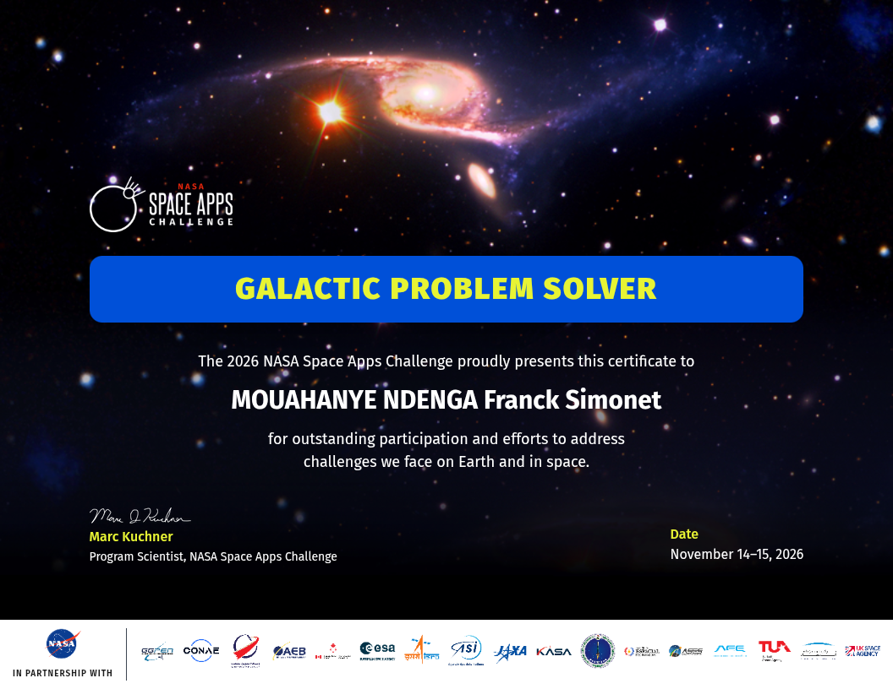

  

  

    
    
    
  

  
<a href="#about-me">About</a> · <a href="#github-dashboard">Stats</a> · <a href="#toolbox">Toolbox</a> · <a href="#selected-builds">Projects</a> · <a href="#learning-in-public">Learning</a> · <a href="#credential">Credential</a>

## GitHub dashboard

  
  
Public repositories only · Repository ownership is checked against GitHub · Refreshed weekly

Run <code>node scripts/update-repo-dashboard.mjs</code> to refresh it locally. A scheduled GitHub Action updates the dashboard every week.

## About me

<strong>Hi, I'm Franck</strong> 

I'm a software developer from **Cameroon** who loves turning ideas into practical software. I focus on reliable backend systems, thoughtful APIs, and solving complex problems with code.

I enjoy backend architecture, API development, database design, and untangling complex problems with code. My goal is simple: keep learning, build useful things, and make each project better than the last.

## Toolbox

  <h3>Languages</h3>
  
  <h3>Backend, frontend &amp; data</h3>
  
  <h3>Tools</h3>
  

## Selected builds

<table>
  <tr>
    <td width="50%" valign="top">
      <h3>🧑‍💻 Franck Coding</h3>
      
My personal developer portfolio platform: a home for my engineering journey, projects, and technical work.

    </td>
    <td width="50%" valign="top">
      <h3>🎓 CollabU</h3>
      
A university-focused collaboration platform designed to connect students and support academic collaboration.

    </td>
  </tr>
  <tr>
    <td width="50%" valign="top">
      <h3>📊 University Result System</h3>
      
An academic management application for student results, academic roles, and marks processing.

    </td>
    <td width="50%" valign="top">
      <h3>🔐 Franckater</h3>
      
An original cipher algorithm and API project exploring text encryption and decryption.

    </td>
  </tr>
  <tr>
    <td colspan="2" valign="top">
      <h3>⚡ GitFast</h3>
      
A desktop GitHub client built with Electron, React, and Vite.

    </td>
  </tr>
</table>

## Learning in public

Right now I'm going deeper into:

- **Software design** — architecture and design patterns.
- **Distributed systems** — microservices and systems that scale.
- **Computer science foundations** — operating systems and computer networks.
- **Backend engineering** — REST APIs, data modeling, and testing.

Alongside that, I'm building **Franck Coding**, developing Python backends and REST APIs, and sharpening my testing and deployment practices.

## Credential

  <a href="https://www.credly.com/badges/7290924f-2eb2-46d9-a110-c6ba14acaa55/public_url">
    
     
    <strong>View my verified Credly credential ↗</strong>
  </a>

## Say hello

Open to meaningful collaborations, interesting engineering challenges, and opportunities to learn and build impactful software.

  
  

 

  <i>“Keep building. Keep learning. Keep improving.”</i>
    
  Made with curiosity, code, and a little Cameroonian sunshine 🇨🇲

