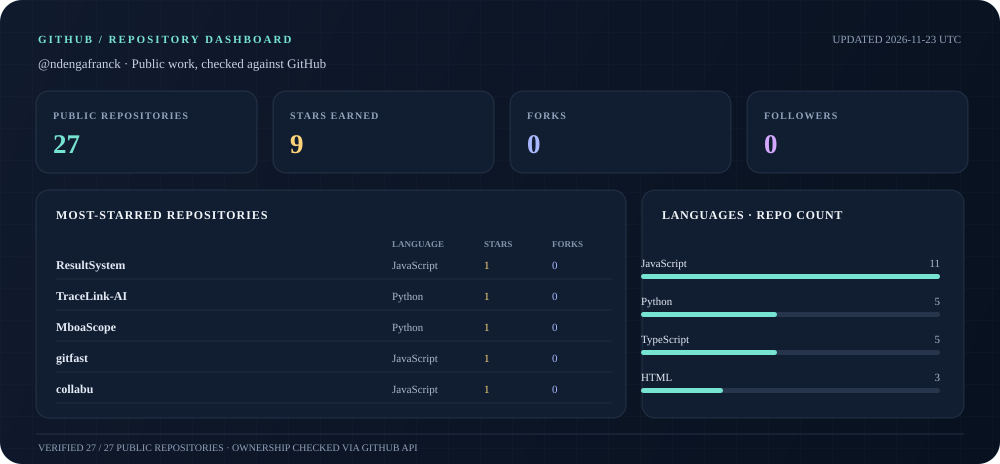

<div align="center">
  

  # Hi, I'm Franck Simonet

  **Software Engineer · Backend & API Development · Systems Engineering**

  <a href="mailto:ndengafranck771@gmail.com"></a>
  <a href="https://www.linkedin.com/in/franck-simonet-mouahanye-ndenga-09884135b/"></a>
  <a href="https://github.com/ndengafranck"></a>

  [About](#about-me) · [GitHub Dashboard](#github-dashboard) · [Toolbox](#toolbox) · [Selected Projects](#selected-projects) · [Learning](#learning-in-public)
</div>

---

## About Me

I am a software engineer from **Cameroon** focused on building reliable software and scalable backend systems. I enjoy designing thoughtful APIs, modeling data effectively, and turning complex technical problems into practical solutions.

My core interests include backend architecture, API development, database design, distributed systems, and software quality. I am motivated by continuous learning and by building products that create real value for users.

## GitHub Dashboard

<div align="center">
  <a href="https://github.com/ndengafranck?tab=repositories">
    
  </a>

  <sub>Public repositories only · Repository ownership verified against GitHub · Refreshed weekly</sub>
</div>

The dashboard can be refreshed locally with:

```bash
node scripts/update-repo-dashboard.mjs
```

A scheduled GitHub Action updates it automatically.

## Toolbox

<div align="center">

### Languages


### Frameworks and Databases


### Tools and Platforms


</div>

## Selected Projects

<table>
  <tr>
    <td width="50%" valign="top">
      <h3>Franck Coding</h3>
      <p>My personal developer portfolio, documenting my projects, technical growth, and engineering work.</p>
    </td>
    <td width="50%" valign="top">
      <h3>CollabU</h3>
      <p>A university-focused collaboration platform that connects students and supports academic teamwork.</p>
    </td>
  </tr>
  <tr>
    <td width="50%" valign="top">
      <h3>University Result System</h3>
      <p>An academic management application for student results, institutional roles, and marks processing.</p>
    </td>
    <td width="50%" valign="top">
      <h3>Franckater</h3>
      <p>An original cipher algorithm and API project for exploring text encryption and decryption.</p>
    </td>
  </tr>
  <tr>
    <td colspan="2" valign="top">
      <h3>GitFast</h3>
      <p>A cross-platform desktop GitHub client built with Electron, React, and Vite.</p>
    </td>
  </tr>
</table>

## Learning in Public

I am currently developing my expertise in:

- **Software design** — architecture principles and design patterns.
- **Distributed systems** — scalable services and microservice architectures.
- **Computer science foundations** — operating systems and computer networks.
- **Backend engineering** — REST APIs, data modeling, testing, and deployment.

Alongside these studies, I am building **Franck Coding**, developing Python backends and REST APIs, and improving my testing and deployment practices.

## Credential

<div align="center">
  <a href="https://www.credly.com/badges/7290924f-2eb2-46d9-a110-c6ba14acaa55/public_url">
    
    <br />
    <strong>View my verified Credly credential ↗</strong>
  </a>
</div>

## Let's Connect

I am open to meaningful collaborations, challenging engineering opportunities, and roles where I can contribute, learn, and build impactful software.

<div align="center">
  <a href="mailto:ndengafranck771@gmail.com"></a>
  <a href="https://www.linkedin.com/in/franck-simonet-mouahanye-ndenga-09884135b/"></a>
</div>

<br />

<div align="center">
  <i>“Keep building. Keep learning. Keep improving.”</i>
  <br /><br />
  <sub>Built with curiosity, code, and a little Cameroonian sunshine 🇨🇲</sub>
</div>
